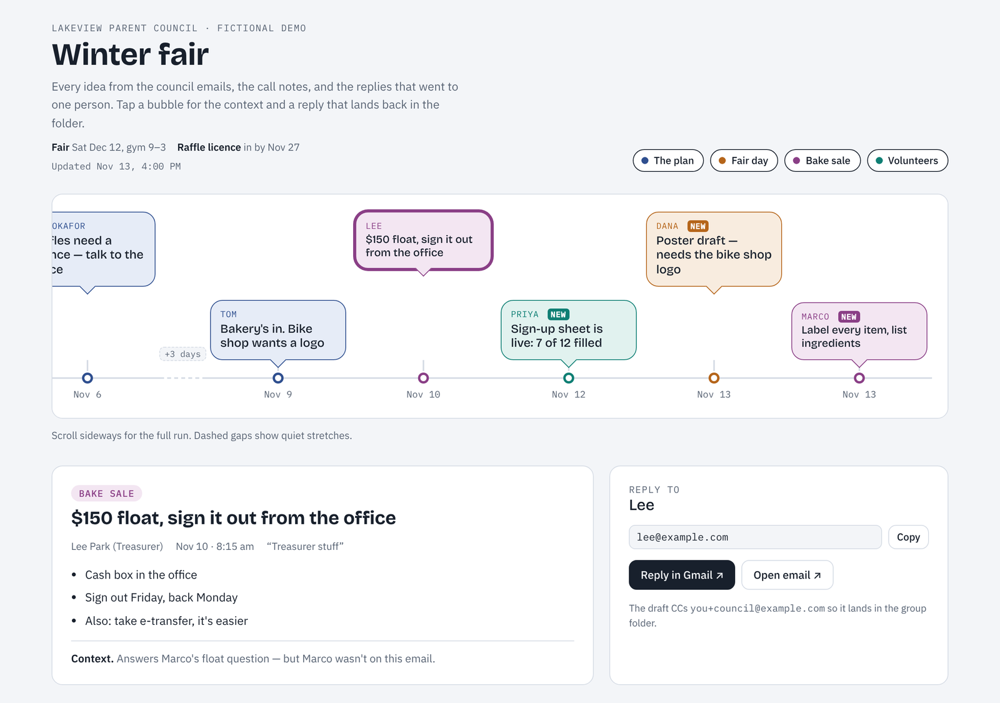
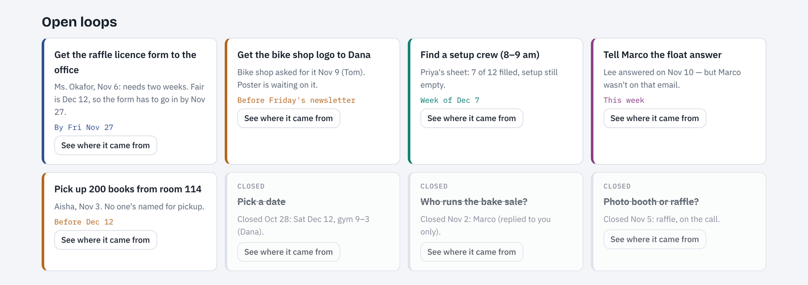
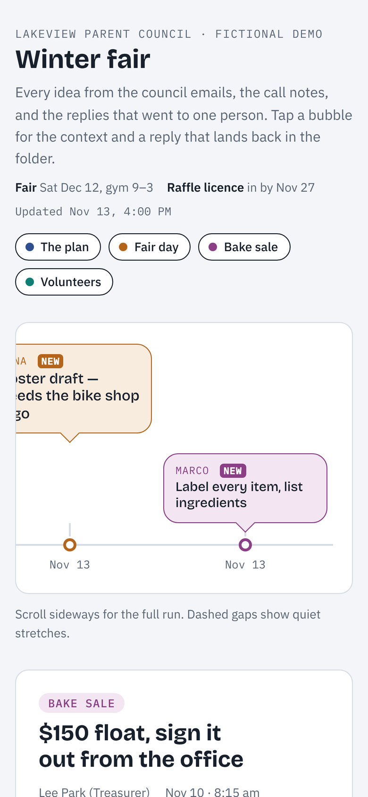

# Agent Skills by Growth Automated

Skills I built while doing real work, cleaned up so anyone can use them. They follow the open [Agent Skills](https://agentskills.io) format, so they work in Claude, Claude Code, Copilot, Cursor, Codex and any other agent that reads `SKILL.md`.

## volunteer-thread-tracker

I chair a school council fundraising committee, and the email is chaos. Half the group replies-all, half replies to one person, someone answers from their iCloud account three days later, and the actual decision happens on a call nobody wrote down.

This skill fixes that:

- **A Gmail filing system.** One label, plus a plus-address tag (`you+group@yourdomain`) you CC on every reply, so answers file themselves. Filters catch the replies that skip the tag.
- **A visual tracker.** A sideways timeline of who said what, colour-coded by topic. Tap any bubble for the context and a one-click reply that lands back in the folder.
- **Open and closed loops.** Every ask, decision and deadline becomes a card. It closes only when an email or a call actually settles it, never because it went quiet.
- **Refresh.** Say "refresh the tracker" and it pulls new mail, flags what's new, closes what got answered, opens what got asked, and tells you the one thing that matters right now.

Built for volunteers: parent councils, committees, clubs, boards. It works for anyone drowning in a group thread.







*All screenshots use a made-up parent council. The real ones are full of parents arguing about toques.*

🎬 [27-second demo](docs/thread-tracker-reel.mp4) · 👀 Open [`examples/demo.html`](skills/volunteer-thread-tracker/examples/demo.html) in a browser to click around.

### Install

**Claude (web/desktop):** download `skills/volunteer-thread-tracker/`, zip the folder, then go to *Customize → Skills → + → Upload skill*.

**Claude Code:**
```bash
git clone https://github.com/rsharma-oss/agent-skills
cp -r agent-skills/skills/volunteer-thread-tracker ~/.claude/skills/
```

**GitHub CLI (v2.90+), any supported agent:**
```bash
gh skill install rsharma-oss/agent-skills volunteer-thread-tracker
```

### Use

Connect Gmail, then:

> Set up a thread tracker for the Riverside PTA emails.

> Refresh the PTA tracker.

It asks before it creates labels or sends anything. It reads freely and drafts freely, but it won't press send without you.

### What it won't do

Make things up. Every bubble and loop is paraphrased from an email, a call note or a doc, and links back to it. If the source doesn't say it, the tracker doesn't either.

## License

MIT. Use it, fork it, make your council's life easier.

---

Made by [Growth Automated](https://growthautomated.ai), Toronto.
